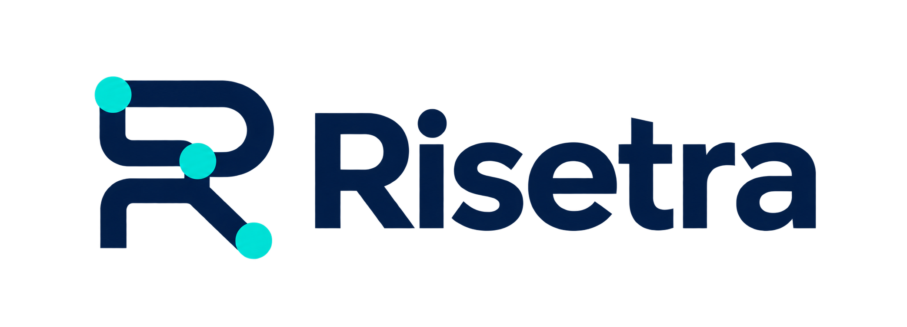
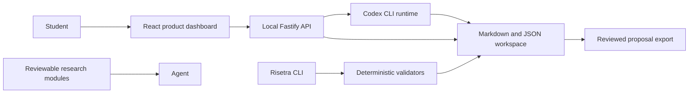

<p align="center">
  
</p>

<p align="center"><strong>Build research you can defend.</strong></p>

Risetra is a local research proposal workspace for students across disciplines. It
connects sources, questions, objectives, methods, chapters, and human review so a
proposal remains explainable beneath the prose.

## The story Risetra follows

A proposal can sound polished while hiding a weak chain of reasoning. A source may not
support the sentence beside it. A method may be familiar but unable to answer the
question. A student may remember the paragraph and forget why the decision was made.

Risetra makes that chain visible:

```text
Observed condition → evidence → gap → question → objective
        → method → expected evidence → human review → seminar rehearsal
```

The product does not generate an unquestioned thesis. Its dashboard starts and resumes
Codex directly, while the student reviews every decision, evidence record, artifact,
and revision in one local product.

## What is implemented

- A `risetra` CLI for workspace creation, validation, module inspection, export, and the
  local dashboard.
- A localhost Fastify API with strict schemas, bounded requests, safe artifact lookup,
  optimistic write protection, and an append-only activity trail.
- A responsive React dashboard for progress, Markdown editing, validation, and explicit
  `DRAFT → REVIEWED → APPROVED` decisions.
- A four-step research setup for student identity, academic context, research materials,
  practical constraints, supervisor guidance, working language, and method preference.
- A guided Codex research session inside the dashboard. The runtime keeps one thread,
  asks one focused question per turn, explains decisions pedagogically, records missing
  evidence, and shows every artifact it changed.
- Safe local intake for institution guidelines and initial source files, including text
  extraction from PDF and DOCX. Uploaded content remains untrusted and unverified until
  a student or reviewer registers its evidence.
- Structured source inventory and question–objective–method alignment editors.
- Crossref literature discovery that imports candidate metadata as unverified evidence
  until the student checks the full text and relevance.
- Downloadable Markdown, DOCX, and PDF proposal exports after the required human review.
- Separate research modules for integrity, evidence, Chapters 1–3, languages,
  institutions, qualitative, quantitative, mixed, experimental, survey, engineering,
  machine learning, doctrinal, historical, literature-based, and practice-based work.
- Thin Codex and Claude Code adapters that share one vendor-neutral skill.
- Deterministic checks for registered citations, synthetic evidence, required
  artifacts, review evidence, alignment records, module metadata, and dependencies.
- A clearly labeled synthetic demo with no fabricated real-world research claims.

## Quick start

Requirements: Node.js 22 or newer, Codex CLI installed, and `codex login` completed.

### Simplest setup on macOS

Download or clone the repository, then double-click **Start Risetra.command**. The
launcher prepares a workspace under `Documents/Risetra Workspace`, starts the local
product, and opens it in the browser. On the first run, complete the four setup screens
and press **Simpan dan mulai**. Codex begins the research guidance inside Risetra.

### Developer setup

```bash
npm install
npm run build
node dist/cli/index.js serve examples/demo
```

Open `http://127.0.0.1:4173`.

Create a workspace, then finish the guided setup in the browser:

```bash
node dist/cli/index.js init ./my-proposal --language id-ID
node dist/cli/index.js serve ./my-proposal
```

The first screen collects the student profile, working topic, observed problem, research
object, location, motivation, available time and resources, supervisor notes, institution
guidelines, and initial source leads. **Simpan dan mulai** creates the first research
charter and starts Codex. The session then progresses through foundation, questions,
evidence, Chapters 1–3, and seminar readiness. Every edited artifact returns to `DRAFT`
until a human reviews it.

### Language is a workspace decision

Dashboard, agent interaction, proposal, source, citation, and quotation languages are
stored separately. A student can write the proposal and use the dashboard in Bahasa
Indonesia while retaining English source quotations:

```bash
node dist/cli/index.js config ./my-proposal \
  --dashboard id-ID \
  --interaction id-ID \
  --proposal id-ID \
  --sources id-ID,en-US \
  --citation-locale id-ID \
  --quotation preserve
```

The same values remain directly reviewable in `risetra.json`. Changing language never
changes a claim, evidence identifier, or approval state automatically.

## Product architecture



Markdown and JSON remain the source of truth. The dashboard never hides proposal state
in a separate database, and the first release requires no Risetra cloud account or
central model API.

Read [the architecture](docs/architecture.md), [module authoring rules](docs/module-authoring.md),
[the student guide](docs/user-guide.md), and [the security model](docs/security.md).

## Human review model

Editing an artifact resets it to `DRAFT`. A student or supervisor records a reviewer
name and note before advancing it. Approved output is exportable; draft reasoning stays
visible instead of being silently promoted.

The bundled research modules are intentionally marked `DRAFT` until the project owner
reviews their academic wording one file at a time. The software is functional, while
the content status honestly represents the remaining human governance step.

## Academic boundaries

Risetra must never invent sources, identifiers, quotations, page numbers, data,
participants, results, or research gaps. It stops at a seminar-proposal-ready Chapter
1–3 workflow. Chapters 4–5 require real collection or experiments and are outside this
release.

## Engineering checks

```bash
npm run format:check
npm run lint
npm run typecheck
npm test
npm run build
npm run validate:demo
node dist/cli/index.js modules
```

Production TypeScript, TSX, and CSS files stay below 300 lines and are split by
responsibility. Tests cover success, failure, boundary, and security-sensitive paths.

## Project status

Version `1.0.1` is a complete local product release for the documented Chapters 1–3
workflow. It preserves workspace write access when a Codex conversation resumes and
keeps proposal-stage markers circular on narrow screens. It has no hosted service and
stores proposal material locally. Codex login and model usage come from the student's
existing Codex installation. The software workflow is complete; bundled academic
modules keep their visible review status and are never misrepresented as
institution-approved rules.

## License

[MIT](LICENSE)
