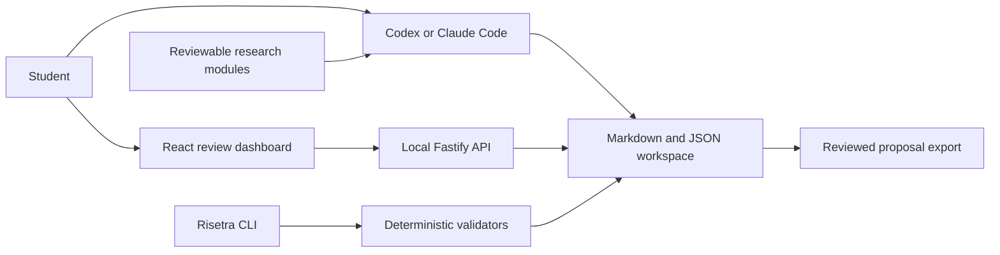

<p align="center">
  
</p>

<p align="center"><strong>Build research you can defend.</strong></p>

Risetra is a local research proposal workspace for students across disciplines. It
connects sources, questions, objectives, methods, chapters, and human review so a
proposal remains explainable beneath the prose.

## The story Risetra follows

A proposal can sound polished while hiding a weak chain of reasoning. A source may not
support the sentence beside it. A method may be familiar but unable to answer the
question. A student may remember the paragraph and forget why the decision was made.

Risetra makes that chain visible:

```text
Observed condition → evidence → gap → question → objective
        → method → expected evidence → human review → seminar rehearsal
```

The product does not generate an unquestioned thesis. It gives Codex or Claude Code a
portable, auditable workflow and gives the student a dashboard for reviewing every
artifact one at a time.

## What is implemented

- A `risetra` CLI for workspace creation, validation, module inspection, export, and the
  local dashboard.
- A localhost Fastify API with strict schemas, bounded requests, safe artifact lookup,
  optimistic write protection, and an append-only activity trail.
- A responsive React dashboard for progress, Markdown editing, validation, and explicit
  `DRAFT → REVIEWED → APPROVED` decisions.
- Separate research modules for integrity, evidence, Chapters 1–3, languages,
  institutions, qualitative, quantitative, mixed, experimental, survey, engineering,
  machine learning, doctrinal, historical, literature-based, and practice-based work.
- Thin Codex and Claude Code adapters that share one vendor-neutral skill.
- Deterministic checks for registered citations, synthetic evidence, required
  artifacts, review evidence, alignment records, module metadata, and dependencies.
- A clearly labeled synthetic demo with no fabricated real-world research claims.

## Quick start

Requirements: Node.js 22 or newer.

```bash
npm install
npm run build
node dist/cli/index.js serve examples/demo
```

Open `http://127.0.0.1:4173`.

Create a workspace:

```bash
node dist/cli/index.js init ./my-proposal \
  --name "Working proposal title" \
  --student "Student Name" \
  --institution "University Name" \
  --discipline "Public Health" \
  --method "Mixed method" \
  --language id-ID

node dist/cli/index.js validate ./my-proposal
node dist/cli/index.js serve ./my-proposal
```

### Language is a workspace decision

Dashboard, agent interaction, proposal, source, citation, and quotation languages are
stored separately. A student can write the proposal and use the dashboard in Bahasa
Indonesia while retaining English source quotations:

```bash
node dist/cli/index.js config ./my-proposal \
  --dashboard id-ID \
  --interaction id-ID \
  --proposal id-ID \
  --sources id-ID,en-US \
  --citation-locale id-ID \
  --quotation preserve
```

The same values remain directly reviewable in `risetra.json`. Changing language never
changes a claim, evidence identifier, or approval state automatically.

## Product architecture



Markdown and JSON remain the source of truth. The dashboard never hides proposal state
in a separate database, and the first release requires no Risetra cloud account or
central model API.

Read [the architecture](docs/architecture.md), [module authoring rules](docs/module-authoring.md),
and [the security model](docs/security.md).

## Human review model

Editing an artifact resets it to `DRAFT`. A student or supervisor records a reviewer
name and note before advancing it. Approved output is exportable; draft reasoning stays
visible instead of being silently promoted.

The bundled research modules are intentionally marked `DRAFT` until the project owner
reviews their academic wording one file at a time. The software is functional, while
the content status honestly represents the remaining human governance step.

## Academic boundaries

Risetra must never invent sources, identifiers, quotations, page numbers, data,
participants, results, or research gaps. It stops at a seminar-proposal-ready Chapter
1–3 workflow. Chapters 4–5 require real collection or experiments and are outside this
release.

## Engineering checks

```bash
npm run format:check
npm run lint
npm run typecheck
npm test
npm run build
npm run validate:demo
node dist/cli/index.js modules
```

Production TypeScript, TSX, and CSS files stay below 300 lines and are split by
responsibility. Tests cover success, failure, boundary, and security-sensitive paths.

## Project status

Version `0.1.0` is a local portfolio release. It is not published to npm and has no
hosted service. The dashboard and CLI run locally, the demo is reproducible, and module
review remains visible rather than being claimed as complete.

## License

[MIT](LICENSE)
